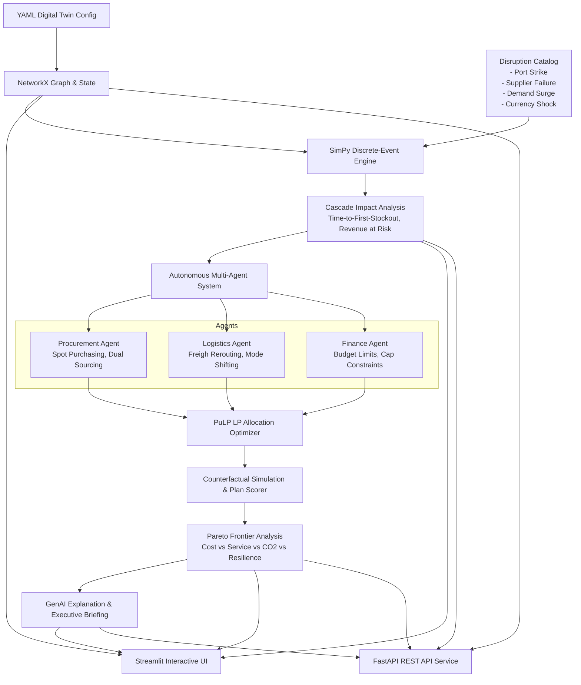

# Supply Chain Disruption Simulator & Autonomous Digital Twin (SC-Disrupt)

[](https://github.com/sathvikshetty520/Supply-Chain-Automation)
[](https://www.python.org/downloads/)
[](https://fastapi.tiangolo.com)
[](https://streamlit.io)
[](LICENSE)

An end-to-end, agentic discrete-event simulation engine and supply chain digital twin platform. Stress-test multi-tier global supply networks against catastrophic disruptions, model cascade propagation in real time, generate autonomous multi-agent recovery strategies, compute multi-objective Pareto trade-offs, and produce C-suite executive briefings.

---

## Architecture Overview



---

## Key Capabilities

1. **Digital Twin Topology Modeling (`scdisrupt.twin`)**
   - Multi-echelon network representation: Tier-1/2 Suppliers, Assembly Plants, Regional Distribution Hubs, and Retail Endpoints.
   - Dynamic NetworkX graph with stochastic lead times, capacity ceilings, inventory policies (reorder points, safety stock), and carbon footprints.

2. **Discrete-Event Simulation Engine (`scdisrupt.simulation`)**
   - SimPy-driven discrete-event runner with Monte Carlo parameter perturbation across orders, transport transit, and production schedules.
   - Comprehensive metric tracking: Fill rate, Mean Service Level, Stockout Days, Total Landed Cost, and Lost Revenue.

3. **Disruption Catalog & Cascade Modeling (`scdisrupt.disruptions`)**
   - Injectable shock scenarios: Port Strikes, Supplier Facility Outages, Sudden Demand Surges, and Currency/Tariff Shocks.
   - Traces bottleneck propagation upstream and downstream, computing earliest point-of-failure and Revenue-at-Risk.

4. **Multi-Agent Autonomous Recovery System (`scdisrupt.agents` & `scdisrupt.optimizer`)**
   - Specialized agent orchestrator:
     - **Procurement Agent**: Identifies alternative suppliers, spot-market contracts, and expedites raw material orders.
     - **Logistics Agent**: Reroutes freight via air/rail, dynamically shifts transport corridors, and splits shipments.
     - **Finance Agent**: Sets working capital and budget caps, enforcing cost constraints.
   - Mathematical optimization via Linear Programming (PuLP) for cost-minimized network flows.

5. **Counterfactual Evaluation & Pareto Frontier (`scdisrupt.scoring`)**
   - Multi-criteria weighted utility scoring balancing Landed Cost, Service Level, CO₂ Footprint, and Resilience.
   - Non-dominated Pareto frontier extraction for transparent executive decision-making.

6. **GenAI Explanation Engine (`scdisrupt.explain`)**
   - Automated root-cause diagnostics and incident response memos formatted for executive leadership.

7. **FastAPI REST API & Interactive UI (`scdisrupt.api` & `scdisrupt.ui`)**
   - Interactive Streamlit dashboard with dynamic force-directed network visualizer, scenario sliders, Pareto charts, and exportable executive memos.
   - Production-ready FastAPI REST endpoints for automated integration and headless pipeline execution.

---

## Repository Structure

```
Supply-Chain-Automation/
├── .github/
│   └── workflows/
│       └── ci.yml                      # GitHub Actions CI matrix (Python 3.11, 3.12)
├── scdisrupt/
│   ├── configs/
│   │   └── sample_network.yaml         # Supply chain digital twin definition
│   ├── scdisrupt/
│   │   ├── twin/                       # Schema, config loader, graph builder
│   │   ├── simulation/                 # SimPy discrete-event engine & Monte Carlo
│   │   ├── disruptions/                # Disruption catalog & cascade analyzer
│   │   ├── agents/                     # Multi-agent orchestrator & agent roles
│   │   ├── optimizer/                  # Linear Programming / PuLP flow solver
│   │   ├── scoring/                    # Counterfactual evaluator, Pareto frontier
│   │   ├── explain/                    # GenAI explanation & executive memos
│   │   └── api/                        # FastAPI REST service & schema models
│   ├── scripts/
│   │   └── run_demo.py                 # End-to-end command-line simulation demo
│   ├── ui/
│   │   └── app.py                      # Interactive Streamlit dashboard
│   ├── tests/                          # Automated unit and integration test suite
│   ├── README.md                       # Package-level documentation
│   └── pyproject.toml                  # Package configuration & dependencies
└── README.md                           # Root repository documentation
```

---

## Installation & Setup

### Prerequisites
- Python >= 3.11
- Git

### 1. Clone & Install Dependencies
```bash
git clone https://github.com/sathvikshetty520/Supply-Chain-Automation.git
cd Supply-Chain-Automation/scdisrupt

# Install package in editable mode with dependencies
pip install -e .
```

### 2. Run Test Suite
```bash
python -m pytest
```
*Current test suite: 23 passing tests covering API endpoints, cascade models, agent formulations, LP optimizer, and UI pipeline.*

---

## User Interfaces & Execution

### 1. Interactive Streamlit Dashboard
Launch the web interface for visual topology inspection and real-time disruption simulation:
```bash
streamlit run ui/app.py
```
Open **`http://localhost:8501`** in your browser.

**Dashboard Features:**
- **Topology & Twin**: Node-link diagram, facility inventory attributes, and transport lane parameters.
- **Cascade Analysis**: Side-by-side comparison of baseline vs. disrupted performance with earliest failure detection.
- **Autonomous Recovery Plans**: Multi-agent proposals ranked by composite utility score with detailed action drill-downs.
- **Pareto Frontier**: Interactive scatter plot of Service Level vs. Landed Cost highlighting non-dominated plans.
- **Executive Memo**: Auto-generated executive briefing with one-click Markdown export.

---

### 2. Command-Line Demo Pipeline
Run an automated end-to-end Monte Carlo simulation with agent recovery and Pareto ranking directly from the terminal:
```bash
# Port Strike Scenario
python scripts/run_demo.py --disruption port_strike --runs 5 --days 45

# Supplier Failure Scenario
python scripts/run_demo.py --disruption supplier_failure --runs 5 --days 45

# Demand Surge Scenario
python scripts/run_demo.py --disruption demand_surge --runs 5 --days 45

# Currency Shock Scenario
python scripts/run_demo.py --disruption currency_shock --runs 5 --days 45
```

---

### 3. FastAPI REST Service
Start the headless REST API service for pipeline orchestration and headless integration:
```bash
uvicorn scdisrupt.api.app:app --host 0.0.0.0 --port 8000 --reload
```
Interactive API documentation:
- **Swagger UI**: `http://localhost:8000/docs`
- **ReDoc**: `http://localhost:8000/redoc`

#### Primary REST Endpoints:
| Method | Endpoint | Description |
|---|---|---|
| `GET` | `/` | Service health check |
| `GET` | `/network` | Digital twin nodes, facilities, and transport lanes |
| `POST` | `/simulate/cascade` | Run Monte Carlo cascade simulation and bottleneck analysis |
| `POST` | `/recover` | Generate and evaluate multi-agent recovery plans with Pareto rankings |

---

## License

This project is licensed under the [MIT License](LICENSE).
